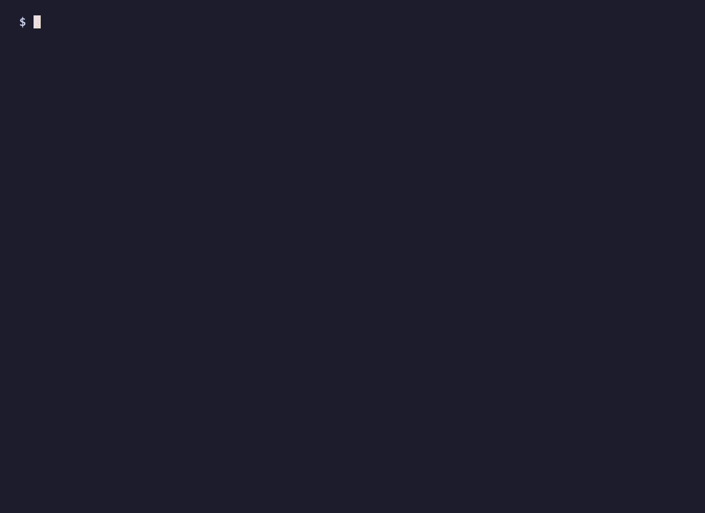

# Dotlane

> Your own lane after the dot.

**Dotlane gives every local project a real HTTPS address, like `https://myapp.traix`, for any
language, on macOS, Linux and Windows.** (macOS today; Linux and Windows are on the
[roadmap](docs/roadmap.md).)

Technically, it is a local domain service (DNS, a trusted certificate authority and a reverse proxy
in one program), controlled from a CLI, a per-project config file or a menu-bar app.

Every local dev server gets a real, trusted HTTPS address on a private domain ending of your
choice — `https://myapp.traix` instead of `http://localhost:5173` — in one command:

```bash
dotlane add myapp 5173
# https://myapp.traix -> localhost:5173
```

No hosts-file edits, no per-site certificates, no root daemon, and no change to how the dev server
itself is started. Adding a domain takes about a second.



## Install

On macOS (Apple Silicon or Intel), with npm:

```bash
npm install -g dotlane
dotlane install                       # once: login service, trusted CA, DNS for .traix
dotlane add myapp 5173                # https://myapp.traix -> localhost:5173
```

`dotlane install` explains the two steps that ask for your password before running them. Or try
it without installing anything, with `npx dotlane install`. Homebrew
(`brew install dotlane/tap/dotlane`) is coming soon. Building from source, upgrading and
uninstalling are in [`docs/setup.md`](docs/setup.md).

## Works with any language

Dotlane needs only a name and a port: it forwards `https://<name>.traix` to whatever listens on
`localhost:<port>`. Python, Node, Go, Ruby, Java, Rust, .NET or a Docker container all work the same
way, started however you already start them.

The exception is PHP. Most PHP apps are a folder of files rather than a running server, so something
must run PHP per request. That support (PHP-FPM, per-site PHP versions) is planned for Phase 3 of the
[roadmap](docs/roadmap.md); until then, use PHP's built-in server or any PHP server on a port.

## Status

**Phase 1 is complete (2026-10-30):** one Go binary on macOS
([`docs/phase-1.md`](docs/phase-1.md)). It covers:
- the daemon: DNS, embedded Caddy, a control socket;
- `install` / `uninstall` / `doctor`;
- `dotlane.toml` with `up` / `down`;
- `migrate` from the Bash prototype;
- hardening.

The integration test on GitHub's macOS runners goes from install to the first site in about a
second, then checks upgrades and a clean uninstall. A real Vite + FastAPI project runs on it day to day.

The Bash prototype it replaced (Caddy and dnsmasq around a ~100-line script, built 2026-10-29)
is kept in [`docs/prototype/`](docs/prototype/).

**Phase 2, packages, is under way** ([`docs/phase-2.md`](docs/phase-2.md)): releases with
GoReleaser, the Homebrew cask and the npm packages are built, each tested on a macOS runner from
install to the first site, then through an upgrade and a clean uninstall. Signing and
notarization come next, then the public release.

## Development (Go version)

Go 1.27. The dev instance uses spare ports and `dev/state/`, so it runs next to a real install
without touching it. `scripts/integration.sh` is the end-to-end test (install, HTTPS through the
system's DNS and trust, uninstall); it changes the system, so it runs on CI's throwaway macOS
runners, not on a development Mac. `go run ./scripts/brandgen` redraws every icon file from the
numbers in it (see [`docs/brand.md`](docs/brand.md)).

Before pushing, `scripts/check.sh` runs what CI's `test` job runs (gofmt, build, vet and
`govulncheck` for Linux and macOS, `go test -race`, the npm tests, `goreleaser check`); about a
minute the first time, while it fetches its pinned tools, then under 20 seconds.

```bash
scripts/check.sh
go build -o bin/dotlane ./cmd/dotlane

./bin/dotlane --config dev/config.toml serve             # terminal 1: DNS :10054, HTTPS :9443
./bin/dotlane --config dev/config.toml add myapp 5173 # terminal 2
./bin/dotlane --config dev/config.toml ls --json

curl --cacert dev/state/caddy/pki/authorities/local/root.crt \
  --resolve myapp.dldev:9443:127.0.0.1 https://myapp.dldev:9443/
dig +short anything.dldev @127.0.0.1 -p 10054             # 127.0.0.1
```

The dev CA is not trusted by the system until the dev instance is installed, hence `--cacert`. To
test the full path (login service, CA trust, `/etc/resolver/dldev`), run in a terminal, since
sudo asks for a password:

```bash
./bin/dotlane --config dev/config.toml install              # then: curl https://<name>.dldev:9443/
./bin/dotlane --config dev/config.toml uninstall --purge
```

Output uses colour on a terminal only; `NO_COLOR=1` turns it off, `CLICOLOR_FORCE=1` forces it
(for `less -R`).

| Package | Role |
| --- | --- |
| `cmd/dotlane` | CLI (`install`, `uninstall`, `doctor`, `migrate`, `add`, `rm`, `ls`, `up`, `down`, `serve`, `version`) |
| `internal/install` | Login service, CA trust and resolver files; `doctor` checks and naming the tools in the way; `migrate` from the prototype. macOS now, other OSes in Phase 4 |
| `internal/ui` | Output on Lip Gloss: one line per step, markers, aligned labels, the `ls` table, colours adapted to light/dark terminals. Help and usage are styled by Fang |
| `internal/daemon` | Runs DNS, Caddy and the control socket around the site registry |
| `internal/dns` | Answers `*.<tld>` with 127.0.0.1 / ::1, refuses everything else |
| `internal/proxy` | Builds Caddy's JSON config; Caddy runs in-process, admin endpoint off |
| `internal/api` | JSON over a Unix socket (mode 0600): handler and client |
| `internal/sites` | Site registry, saved atomically to `sites.json`; which project owns each name |
| `internal/project` | `dotlane.toml`: finding it, reading it, what `up` and `down` change |
| `internal/config` | `config.toml`: endings, ports, state directory |

## How it works, in one picture

The picture shows the Bash prototype, which this Mac ran until 2026-10-30. The Go version keeps the same
flow with DNS, Caddy and the CA inside one `dotlane` process: see
[`docs/how-it-works.md`](docs/how-it-works.md).


The same flow as text:

```text
  browser / curl / any tool
          │  myapp.traix ?
          ▼
  macOS resolver ── /etc/resolver/traix ──▶ dnsmasq 127.0.0.1:10053
          │                                   "*.traix → 127.0.0.1, ::1"
          ▼
  https://127.0.0.1:443  ──▶  Caddy  (one site file per domain, local CA certificates)
                                │  reverse_proxy
                                ▼
                         localhost:5173  (the dev server, unchanged)
```

## Documentation

| File | What it covers |
| --- | --- |
| [`docs/brand.md`](docs/brand.md) | The mark, colours, type and Dotlane's own pages; the files are in `assets/brand/` |
| [`docs/how-it-works.md`](docs/how-it-works.md) | What the Go version does and how: the daemon, a request end to end, certificates, install, projects, `doctor`, `migrate` |
| [`docs/architecture.md`](docs/architecture.md) | The Bash prototype: components, request flow, and why each design choice was made |
| [`docs/diagrams/dotlane-components.svg`](docs/diagrams/dotlane-components.svg) | Diagram of the tools and libraries used and how a request flows (light and dark mode) |
| [`docs/setup.md`](docs/setup.md) | Install (npm or source; Homebrew coming soon), first site, upgrade, migrate from the prototype, uninstall (macOS) |
| [`docs/cli.md`](docs/cli.md) | Command reference: every command, `dotlane.toml`, `config.toml`, output and exit codes |
| [`docs/prototype/`](docs/prototype/) | The Bash prototype's setup and command reference, kept for reference |
| [`docs/app-integration.md`](docs/app-integration.md) | What an app needs (allowed hosts, origins, cookies, live reload), with a Vite + FastAPI app as the example |
| [`SECURITY.md`](SECURITY.md) | How to report a vulnerability, where the CA key lives, and what is in scope |
| [`CONTRIBUTING.md`](CONTRIBUTING.md) | Issues, working on the code, what a pull request needs |
| [`CHANGELOG.md`](CHANGELOG.md) | What changed in each version; every version gets a section before it is tagged |
| [`docs/distribution.md`](docs/distribution.md) | One binary, many channels: how a tag becomes the GitHub Release, the Homebrew cask and the npm packages; Linux, Windows and the desktop apps |
| [`docs/launch.md`](docs/launch.md) | Launch day: the steps that take Dotlane public, in order, with the exact commands |
| [`docs/releasing.md`](docs/releasing.md) | What a release contains and how to cut one (GoReleaser, `v*` tags, draft releases, npm packages) |
| [`docs/security-guide.md`](docs/security-guide.md) | How the repositories, secrets, releases and website are protected; the checklist before going public |
| [`docs/security.md`](docs/security.md) | Trust model of the local certificate authority, what runs with which privileges |
| [`docs/troubleshooting.md`](docs/troubleshooting.md) | Common problems and their fixes, and lessons from the prototype |
| [`docs/product-notes.md`](docs/product-notes.md) | Landscape, differentiators, gaps between this prototype and a product |
| [`docs/roadmap.md`](docs/roadmap.md) | Phases from prototype to product: Go core, Homebrew/npm, PHP, Linux/Windows, desktop app |
| [`docs/phase-1.md`](docs/phase-1.md) | Phase 1 in milestones: the Go daemon, install, `doctor`, `dotlane.toml`, migration |

## Files

`files/` holds the exact configuration in use, so the setup can be reproduced or packaged:

| Path | Installed at |
| --- | --- |
| `files/bin/dotlane` | `~/.local/bin/dotlane` |
| `files/dnsmasq/traix.conf` | `~/.config/dnsmasq/traix.conf` |
| `files/launchd/dev.traix.dnsmasq.plist` | `~/Library/LaunchAgents/dev.traix.dnsmasq.plist` (with `$HOME` expanded) |
| `files/caddy/Caddyfile` | `/opt/homebrew/etc/Caddyfile` (with `$HOME` expanded) |
| `files/caddy/sites/myapp.caddy` | `~/.config/caddy/sites/myapp.caddy` (written by `dotlane add`) |
| `files/resolver/traix` | `/etc/resolver/traix` (root-owned) |

## Licence

Apache-2.0 ([`LICENSE`](LICENSE), [`NOTICE`](NOTICE)), the same licence as Caddy, which the binary
embeds.
